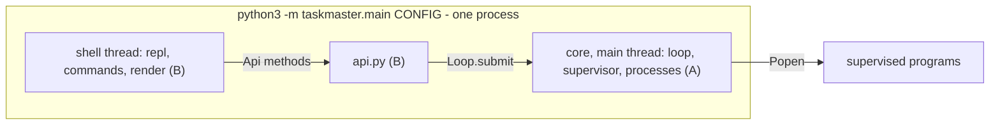
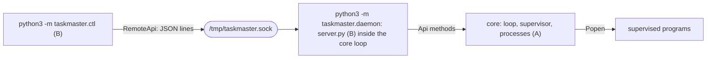
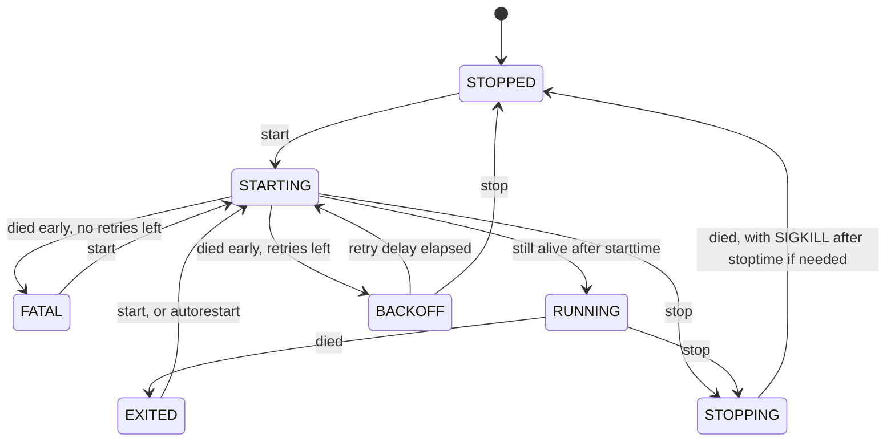
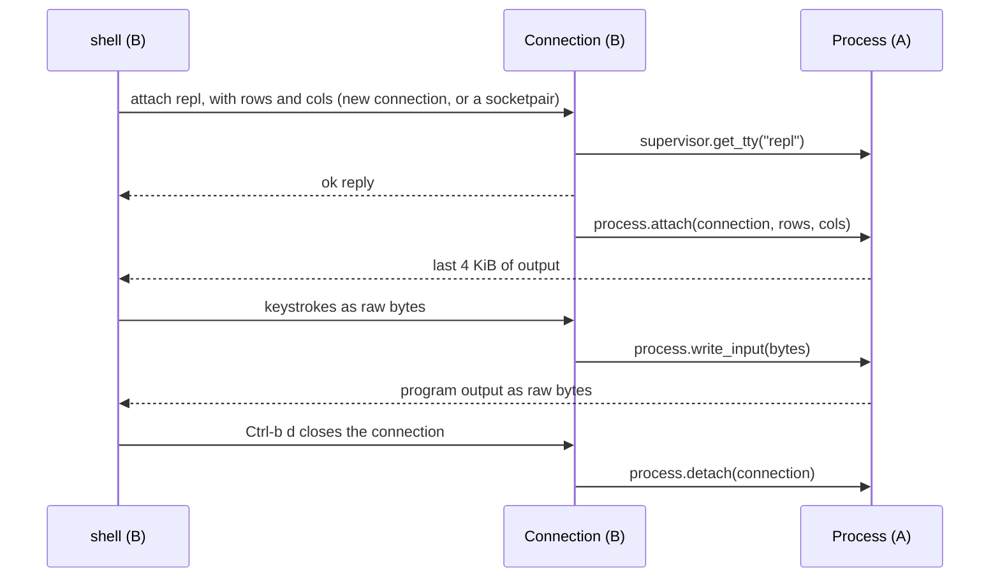

# Taskmaster: architecture

The design of the whole project, bonus included. It fits the skeleton that is already in the repo: `taskmaster/core/` is Person A's, and `taskmaster/shell/`, `api.py` and `main.py` are Person B's.

- What A and B must agree on is in [CONTRACTS.md](CONTRACTS.md). Change it only after both agree.
- If an issue and these documents disagree, the documents win: tell the other person and fix the issue.

---

## 1. Scope

We are building a process supervisor in the spirit of `supervisord`, in Python. The mandatory part must be flawless before any bonus work starts. The bonus covers the four ideas in the subject: privilege de-escalation, client/server, alerts and attach. Attach counts for 2 points on the grading sheet.

**Goals**

- Pass every item on the grading sheet, and be able to _prove_ each one in the defense with the log file, `status` and `ps`.
- One core and one shell. The bonus reuses both: it only changes how the shell reaches the core.

**Non-goals (on purpose)**

- Log rotation: `logrotate` with `copytruncate` covers it.
- TCP sockets: UNIX sockets only.
- Email or webhook alerts: syslog is enough for the bonus point.
- supervisor's program groups, priorities and event listeners.
- Forwarding terminal resizes in the middle of an attach.
- Re-adopting orphaned children after taskmaster dies from `kill -9`. supervisor does not do it either.

**A failure, even if it "works"**

- Restarting, on reload, programs whose config did not change.
- The core blocking: `sleep`, a blocking `wait`, or a blocking write to a client.
- Zombies, or a `status` that lies after a `kill -9`.
- `Ctrl-C` killing taskmaster.
- A broken terminal after `quit`, an attach or a crash.
- A bonus feature breaking the mandatory part.

**Constraints**

- **Python ≥ 3.10.** The school machines have 3.10.12, so the minimum cannot go higher, and the VM has 3.14. `Popen` needs at least 3.9 anyway, for `umask`, `user`, `group` and `extra_groups`.
- Every module starts with `from __future__ import annotations`, so that type hints are not evaluated at import time, and a hint can name a class defined further down the file.
- `match` statements are allowed (they need 3.10).
- **Libraries:** the standard library plus PyYAML only. PyYAML is allowed because it parses the config.
  - Tests use `unittest`, not `pytest`, to stay clear of the external-library rule.
- **Linux VM.** The mandatory part runs without root. The privilege bonus needs root.

## 2. Decisions

| Decision                                                                                                                                | Why                                                                                                                   |
| --------------------------------------------------------------------------------------------------------------------------------------- | --------------------------------------------------------------------------------------------------------------------- |
| Python, with a YAML config that uses the subject's field names                                                                          | team choice; the subject's example is YAML                                                                            |
| Split by layer: A owns `core/`, B owns `shell/`, `api.py` and `main.py`                                                                 | few git conflicts; it is the skeleton already in the repo                                                             |
| The core never prints or reads the terminal. The shell only calls a _backend_: `Api` in-process, `RemoteApi` over a socket in the bonus | the bonus becomes a second backend plus a server; the shell does not change                                           |
| The mandatory part is one process: the core loop in the main thread, the shell in a second thread, calls handed over with `Loop.submit` | no socket to break in the defense; signals only work in the main thread; the shell may block, the core may not        |
| Single-threaded core on `selectors`                                                                                                     | process state has one owner, so no locks; the loop never blocks                                                       |
| `Popen` with `start_new_session=True`                                                                                                   | each child has its own session and group: the terminal's `Ctrl-C` does not reach it, and `killpg` gets the whole tree |
| Reap with `popen.poll()` on every live process                                                                                          | `waitpid(-1)` behind `Popen`'s back makes `Popen.poll()` return `0` later (tested)                                    |
| `stopsignal` and `SIGKILL` go to the process group (`os.killpg`)                                                                        | no orphaned grandchildren                                                                                             |
| Reload: "unchanged" means equal normalized config; "changed" means remove, then add                                                     | simple, and unchanged programs are never touched                                                                      |
| Replies are immediate: `start` does not wait for RUNNING                                                                                | the loop never blocks; `status` shows the outcome                                                                     |
| Bonus protocol: UNIX socket, one JSON message per line                                                                                  | easy to frame, and easy to debug with `nc -U`                                                                         |
| Attach only for `tty: true` programs; detach with `Ctrl-b d`                                                                            | a pty is needed; same keys as tmux                                                                                    |
| Alerts through syslog                                                                                                                   | the standard `logging` module already supports it                                                                     |
| One entry module per program: `main.py`, `daemon.py`, `ctl.py`                                                                          | the two bonus programs are separate, as in supervisor                                                                 |

## 3. System overview





**The core (A)** lives in `taskmaster/core/`. It owns every process and runs in the main thread. It never prints and never reads the terminal.

**The shell (B)** lives in `taskmaster/shell/`. It only talks to a _backend_, an object with the methods in [CONTRACTS §5.2](CONTRACTS.md#52-backend-and-api).

- In the mandatory part the backend is `Api` (`taskmaster/api.py`): same process, direct calls.
- In the bonus the backend is `RemoteApi` (`taskmaster/client.py`): the same methods, over a UNIX socket.

**Three programs**, one entry module each:

| Program               | Command                                      | What runs                                                                                                            |
| --------------------- | -------------------------------------------- | -------------------------------------------------------------------------------------------------------------------- |
| taskmaster            | `python3 -m taskmaster.main CONFIG`          | core in the main thread, shell in a second thread, `Api` between them                                                |
| taskmasterd (bonus)   | `python3 -m taskmaster.daemon [-n] CONFIG`   | core plus socket server; goes to the background unless `-n` is given                                                 |
| taskmasterctl (bonus) | `python3 -m taskmaster.ctl [COMMAND [ARG…]]` | shell only, with `RemoteApi`; interactive with no arguments, otherwise one command and exit code 0 (ok) or 1 (error) |

An invalid config, or another taskmaster already running, prints the error on stderr and exits with code 1. That is the only place where the program prints outside the shell, and it happens before any loop, thread or daemon exists.

## 4. Repository layout

A file marked with an issue (T16, T19…) does not exist yet: that issue creates it.

```
Taskmaster/
├── Makefile                     install, run, test, clean
├── README.md
├── CONTRIBUTING.md              how we work together: branches, PRs, reviews
├── requirements.txt             PyYAML; ruff for the pre-commit hook (never imported)
├── ruff.toml                    lint and format settings
├── .gitignore
├── .githooks/pre-commit         ruff check and ruff format --check; `make install` turns it on
├── .github/
│   ├── ISSUE_TEMPLATE.md
│   ├── PULL_REQUEST_TEMPLATE.md
│   └── workflows/ci.yml         unittest on Python 3.10 and 3.14
├── docs/
│   ├── ARCHITECTURE.md          this file
│   └── CONTRACTS.md
├── taskmaster/
│   ├── __init__.py
│   ├── main.py                  B   program 1: core and shell in one process
│   ├── api.py                   B   Api: the thread-safe backend over the core
│   ├── protocol.py              A+B   error codes, ok() and err(), Backend; bonus: wire format, attach types
│   ├── core/                    A
│   │   ├── __init__.py
│   │   ├── config.py            load and validate the YAML into ProgramConfig
│   │   ├── process.py           one instance: Popen, state machine (bonus: pty)
│   │   ├── supervisor.py        instance table, commands, reap, deadlines, shutdown
│   │   ├── reload.py            the diff between two configs
│   │   ├── loop.py              event loop, signals, call queue
│   │   └── logger.py            the log file (bonus: syslog)
│   ├── shell/                   B
│   │   ├── __init__.py
│   │   ├── commands.py          command table, parsing, dispatch to the backend
│   │   ├── render.py            status table and messages
│   │   ├── repl.py              readline loop, completion, Ctrl-C and Ctrl-D
│   │   └── attach.py            (T19, bonus) raw-mode attach client
│   ├── server.py                (T16, bonus) B   socket server, runs inside the core loop
│   ├── client.py                (T17, bonus) B   RemoteApi: the same methods over the socket
│   ├── daemon.py                (T17, bonus) B   program 2
│   └── ctl.py                   (T17, bonus) B   program 3
├── tests/                       unittest, one test_<module>.py per module
│   ├── __init__.py
│   └── fakes.py                 FakeBackend
└── demo/                        test programs and demo configs (bonus.yaml: T14); DEFENSE.md (T13)
```

## 5. Concurrency model

- **Main thread = core.** One `selectors` loop (`core/loop.py`) is the only thing that reads or changes process state.
- **Shell thread**, in `taskmaster.main` only. It calls `Api` methods, and each one waits for the core's answer.
- There are no other threads.

Signals and `signal.set_wakeup_fd` only work in the main thread, so the core must live there. The shell blocks in `input()`, which the core must never do.

```python
class Loop:
    def run(self, sup):                               # main thread only
        signal.set_wakeup_fd(self._w)                 # every received signal writes its number (1 byte) to the pipe
        for sig in (SIGCHLD, SIGHUP, SIGTERM, SIGINT, SIGQUIT):
            signal.signal(sig, lambda *_: None)       # empty handler; the loop does the work. Never SIG_IGN.
        self.sel.register(self._r, EVENT_READ, self._on_wakeup)   # signals and submitted calls both arrive here
        sup.autostart()
        while not sup.finished:
            timeout = sup.time_to_next_deadline()     # nearest deadline, or None
            for key, mask in self.sel.select(timeout):
                key.data(key.fileobj, mask)           # an exception in a callback is logged, never fatal
            sup.tick(time.monotonic())                # apply the deadlines that passed
        # then: stop accepting calls, fail the queued ones, put the old signal handlers back
```

**Calls from the shell.** `Loop.submit(fn, *args)` is the only way another thread talks to the core.

- It puts the call on a `queue.SimpleQueue`, writes one `\0` byte to the wake-up pipe, and returns a `Future`. The loop runs the call on its own thread.
- If the call raises, the loop logs it and the future holds `err(INTERNAL, ...)`. The shell never sees a traceback.
- `submit` ignores a `BlockingIOError` on that write: it only means the pipe already holds wake-ups.
- A small lock makes `submit` and the loop's exit atomic. Once the loop has stopped, `submit` raises `BackendError`, and the calls still queued fail with it. Nobody waits forever.
- `Api` methods are `loop.submit(sup.stop, names).result()`. On the loop's own thread (the bonus server) they call `sup.stop(names)` directly, because a thread must not wait for itself.
- `run()` puts the previous signal handlers and wake-up fd back when it returns. Tests rely on it.
- `run()` also forgets its thread when it returns. Otherwise the main thread would still count as "the loop thread", and a late `Api` call would reach the supervisor directly instead of failing with `BackendError` (the prototype hit this).

**Deadlines.** Each instance has at most **one** active deadline:

- the end of `starttime`, in STARTING;
- the next retry, in BACKOFF;
- the `SIGKILL`, in STOPPING.

Deadlines use `time.monotonic()`, so a change of the wall clock does not affect them.

| Signal received by taskmaster | Action                                                                                             |
| ----------------------------- | -------------------------------------------------------------------------------------------------- |
| `SIGCHLD`                     | `sup.reap()`                                                                                       |
| `SIGHUP`                      | `sup.reload()`                                                                                     |
| `SIGTERM`                     | `sup.shutdown()`                                                                                   |
| `SIGQUIT`                     | `sup.shutdown()`, like `SIGTERM`: otherwise `Ctrl-\` would dump core and leave the children behind |
| `SIGINT`                      | ignored when `interactive` (it is the shell's `Ctrl-C`); `sup.shutdown()` in the daemon            |

**Reap.** Several children can die and produce a single `SIGCHLD`, so `reap()` polls **every** live process:

```python
for p in self.alive():
    p.poll()          # popen.poll(); a negative code means "killed by signal -code"
```

We never use `os.waitpid(-1, WNOHANG)`. With `Popen`, reaping must go through `Popen`. If `waitpid(-1)` reaps a child behind its back, that process's `Popen.poll()` returns `0` afterwards: in a test, an `exit 7` showed up as `0`.

**Never `SIG_IGN`.** An ignored signal stays ignored in the child after `exec`. With `SIGINT` set to `SIG_IGN`, every supervised program would ignore `SIGINT`, and `stopsignal: INT` would stop working. A Python handler is reset to the default on `exec`. Both behaviors were tested.

**Terminal.** `main.py` saves the terminal's `termios` before it starts the shell thread, and restores it when `Api.run()` returns. The shell thread may be in the middle of a readline line when the process exits, and a killed daemon thread cannot clean up after itself.

**`Ctrl-C` in the shell**

- In `taskmaster.main`, the signal goes to the core, which ignores it. The typed line stays.
- In `taskmaster.ctl`, the `KeyboardInterrupt` in `input()` clears the line. While the shell waits for a reply, it ignores `Ctrl-C`, so that replies stay in sync.

## 6. Processes and state machine

**Spawning** (`core/process.py`)

```python
Popen(cfg.cmd, cwd=cfg.workingdir, env={**os.environ, **dict(cfg.env)},
      umask=-1 if cfg.umask is None else cfg.umask,
      stdin=DEVNULL, stdout=file_or_DEVNULL, stderr=file_or_DEVNULL,
      start_new_session=True)  # own session and group: the terminal's Ctrl-C never reaches it, and killpg gets the whole tree
```

- The parent opens the output files in `"ab"` mode and closes its own copies right after `Popen`.
- If `Popen` raises (command not found, permission denied, bad `workingdir`, user switch refused), it counts as a death during STARTING. The message is kept for `status`.



| From                   | Event                                                                             | To       | Action                                                                                                   |
| ---------------------- | --------------------------------------------------------------------------------- | -------- | -------------------------------------------------------------------------------------------------------- |
| STOPPED, EXITED, FATAL | `start` (command or autostart)                                                    | STARTING | `Popen`; deadline = now + `starttime`; reset attempts                                                    |
| STARTING               | deadline passes, process alive                                                    | RUNNING  | reset attempts                                                                                           |
| STARTING               | dies, or `Popen` raised                                                           | BACKOFF  | attempts += 1; deadline = now + attempts seconds (1 s, 2 s, 3 s…)                                        |
| STARTING               | same, but 1 + `startretries` attempts already made                                | FATAL    | log WARNING "gave up"                                                                                    |
| BACKOFF                | deadline passes                                                                   | STARTING | `Popen`                                                                                                  |
| RUNNING                | dies                                                                              | EXITED   | "expected" if the code is in `exitcodes`; a death by signal is never expected; log WARNING if unexpected |
| EXITED                 | right away, if `autorestart: always`, or `unexpected` and the exit was unexpected | STARTING | `Popen`                                                                                                  |
| STARTING, RUNNING      | `stop`                                                                            | STOPPING | `os.killpg(pid, stopsignal)`; deadline = now + `stoptime`                                                |
| BACKOFF                | `stop`                                                                            | STOPPED  | cancel the next attempt                                                                                  |
| STOPPING               | deadline passes                                                                   | STOPPING | `os.killpg(pid, SIGKILL)`; log WARNING "killed after stoptime"                                           |
| STOPPING               | dies                                                                              | STOPPED  | if a `restart` is pending, `start`                                                                       |

- Every transition is logged, with its reason.
- A `ProcessLookupError` from `killpg` (the group is already gone) is ignored.
- With `starttime: 0`, the process becomes RUNNING on the next tick.

## 7. Reload

`Supervisor.reload()` runs for `SIGHUP` and for the `reload` command. It keeps `target`: for each program, the config it is supposed to have.

1. Re-read the file given at startup and validate all of it. If it is invalid, log ERROR, reply `BAD_CONFIG`, and change nothing.
2. `reload.diff(target, new)` compares the two, program by program (by name), and `target` becomes `new`.

| Case                                                     | What happens                                                           |
| -------------------------------------------------------- | ---------------------------------------------------------------------- | ------------------------------------------------------------------------------------------------------------------------------- |
| unchanged (`ProgramConfig` equal, field by field)        | nothing, whatever the state (FATAL and STOPPED included)               |
| +                                                        | new                                                                    | create the instances; start them if autostart. If an old instance still holds one of the new names, wait for it first, as below |
| removed                                                  | stop every instance; once all are stopped, delete them                 |
| changed (any field, `autostart` and `numprocs` included) | like "removed" and, once the old instances are all stopped, like "new" |

Stopping during a reload, by state:

- STARTING or RUNNING become STOPPING (`stopsignal`, then `SIGKILL` after `stoptime`);
- BACKOFF becomes STOPPED at once;
- STOPPING keeps stopping;
- STOPPED, EXITED and FATAL are already stopped.

**Pending changes**

- What waits is stored per program: `pending[name] = new config, or None if the program was removed`. Every program in the diff gets an entry, new ones included.
- `reload()` and every `tick()` apply an entry once nothing it replaces is alive: the program's old instances, and any old instance that holds one of its new names.
  - Most new programs are applied in the same call.
  - A new program waits when it was removed by one reload and added back by the next before it stopped, or when it takes the name of another program's instance (`web_00` removed, `web` added with `numprocs: 2`). Creating it at once would replace a live `Process` and lose its child.
- A second reload before that replaces the pending entry. It compares against `target`, which already holds the first reload's result.
- While a program has a pending entry, `start` and `restart` on its instances return `BUSY`, per instance, so `start all` still starts the other programs.
- A shutdown drops every pending entry (§8).

The reply is `ok({"added": [...], "changed": [...], "removed": [...]})`, and the log gets one line: `reload: added [...], changed [...], removed [...]`.

## 8. Shutdown

A shutdown can come from:

- the `shutdown` command;
- `SIGTERM`;
- `SIGINT` in the daemon;
- `quit` or `Ctrl-D` in `taskmaster.main`.

`Supervisor.shutdown()` replies `{"ok": true, "msg": "shutting down"}` right away. From then on, `start`, `restart` and `reload` return `BUSY`. It also drops the pending reload entries (§7), so nothing new starts while everything stops.

1. Stop every instance as `stop` does (`stopsignal`, then `SIGKILL` after `stoptime`), without blocking the loop.
2. When no instance is alive, `sup.finished` becomes true and the loop ends. Then:
   - the log gets "taskmaster stopped";
   - calls still queued fail with `BackendError`;
   - `Api.run()` returns 0, and the caller cleans up: `main.py` restores the terminal, and the daemon closes the server and deletes the socket.

## 9. Logging and alerts

**Log file** (`core/logger.py`)

- Standard `logging` module, with a `FileHandler` on `taskmaster.log` in append mode, in the folder taskmaster was started from.
- Level INFO, format `%(asctime)s %(levelname)s %(message)s`.
- Only the core writes to the log, always from the main thread.
- A second call to `setup()` (tests do it, and so does a second `Api`) starts over: it removes every old handler, the syslog one included, so nothing is logged twice.

**Events by level**

- **INFO:** taskmaster started (with its pid) and stopped, spawn, entered RUNNING, expected exit, stop, restart, reload summary.
- **WARNING:** unexpected exit (with the code or the signal), `SIGKILL` after `stoptime`, FATAL (gave up).
- **ERROR:** an exception caught by the loop, with its traceback; an invalid config on reload (§7).

**Bonus: alerts** ([§11.3](#113-alerts)).

## 10. Core internals

These are Person A's own interfaces. Person B only needs [CONTRACTS §5](CONTRACTS.md#5-code-interfaces).

```python
# taskmaster/core/config.py
@dataclass(frozen=True)
class ProgramConfig:                        # values already normalized (CONTRACTS §4)
    name: str
    cmd: tuple[str, ...]                    # shlex.split(cmd)
    numprocs: int
    umask: int | None                       # None = inherit
    workingdir: str | None                  # absolute path; None = inherit
    autostart: bool
    autorestart: str                        # "always" | "never" | "unexpected"
    exitcodes: tuple[int, ...]
    startretries: int
    starttime: float
    stopsignal: signal.Signals
    stoptime: float
    stdout: str | None                      # absolute path; None = /dev/null
    stderr: str | None
    env: tuple[tuple[str, str], ...]        # sorted (key, str(value)) pairs
    user: str | None                        # bonus, added by T14
    tty: bool                               # bonus, added by T18

    def instance_names(self) -> list[str]: ...   # ["web"] or ["web_00", "web_01", ...]
```

```python
# taskmaster/core/process.py
class State(enum.Enum):                     # .value is what goes on the wire
    STOPPED = "STOPPED"
    STARTING = "STARTING"
    RUNNING = "RUNNING"
    BACKOFF = "BACKOFF"
    STOPPING = "STOPPING"
    EXITED = "EXITED"
    FATAL = "FATAL"

class Process:
    def __init__(self, name: str, config: ProgramConfig,
                 log: logging.Logger, sel: selectors.BaseSelector): ...
    name: str
    config: ProgramConfig
    state: State
    deadline: float | None                  # time.monotonic(); at most one active (§5)

    def is_alive(self) -> bool: ...         # a child exists and has not been reaped
    def poll(self) -> None: ...             # popen.poll(); on exit, apply the §6 transition
    def on_deadline(self, now: float) -> None: ...
    def start(self) -> dict: ...            # per-instance result, following the CONTRACTS §1 state × command table
    def stop(self) -> dict: ...
    def restart(self) -> dict: ...
    def info(self) -> dict: ...             # one status row (CONTRACTS §3)
```

A per-instance result looks like one of these:

```python
{"name": "web_00", "ok": True, "msg": "starting"}
{"name": "web_00", "ok": False, "error": "ALREADY_STARTED", "msg": "already started"}
```

```python
# taskmaster/core/reload.py
@dataclass(frozen=True)
class Plan:                                 # names are sorted; unchanged programs are not listed
    added: tuple[str, ...]
    changed: tuple[str, ...]
    removed: tuple[str, ...]

def diff(target: dict[str, ProgramConfig], new: dict[str, ProgramConfig]) -> Plan: ...
```

```python
# taskmaster/core/supervisor.py: what the loop calls (the commands are in CONTRACTS §5.3)
class Supervisor:
    finished: bool                          # True once a shutdown has completed
    def autostart(self) -> None: ...
    def reap(self) -> None: ...
    def tick(self, now: float) -> None: ...
    def time_to_next_deadline(self) -> float | None: ...
```

```python
# taskmaster/core/logger.py
def add_syslog(log: logging.Logger) -> None: ...   # bonus
```

**The shell** (Person B's own interfaces)

```python
# taskmaster/shell/commands.py
@dataclass(frozen=True)
class Command:
    name: str
    usage: str                              # e.g. "start <name>... | all"
    help: str                               # one line
    min_args: int
    max_args: int | None                    # None = no limit
    takes_names: bool                       # completion offers program and instance names

COMMANDS: dict[str, Command]

@dataclass(frozen=True)
class Result:
    text: str                               # what to print; may be empty
    quit: bool = False                      # the user asked to leave the shell
    ok: bool = True                         # False when a reply had ok: False (the exit code of taskmaster.ctl)

def execute(line: str, backend: Backend) -> Result: ...

# taskmaster/shell/render.py
def status_table(rows: list[dict], now: float) -> str: ...
def results(reply: dict) -> str: ...        # per-instance lines, reload summary, or an error

# taskmaster/shell/repl.py
def run(backend: Backend, *, shutdown_on_quit: bool) -> None: ...
```

## 11. Bonus features

### 11.1 Privilege de-escalation

- Each program can set `user: name`. When taskmaster runs as root, these go to `Popen`: `user=pw.pw_uid, group=pw.pw_gid, extra_groups=os.getgrouplist(name, pw.pw_gid)`.
  - `Popen` then calls `setgroups`, `setgid` and `setuid`, in that order.
  - They are passed only when taskmaster runs as root, because without root `setgroups` fails even for the current user (tested).
- **Without root**
  - A `user` equal to the current user is ignored.
  - Any other `user` counts as a spawn error. It ends in FATAL with the message "user switching needs root".
- The environment (`HOME`, `USER`) does not change, as in supervisor.
- **Files owned by root:** the socket is `0600` and owned by root. The `stdout` and `stderr` files are created by root before the user switch.
- **The user is checked before those files are opened**, so a refused switch leaves no file behind. With `fs.protected_regular` (on by default on Ubuntu), root and a normal user cannot reopen each other's files in `/tmp`, and a `Permission denied` would hide "user switching needs root" (tested).
- **Proof for the defense:** `ps -o user,pid,cmd`, or the `Uid`, `Gid` and `Groups` lines of `/proc/<pid>/status`. `Groups` shows that root's group `0` did not leak.

### 11.2 Client and server

**`python3 -m taskmaster.daemon [-n] CONFIG` (taskmasterd)**

- It builds `Api(path, interactive=False)`, so config errors still reach the terminal. Then `Server(SOCKET_PATH, api)`, which refuses to start if another taskmaster answers on the socket.
- Then it becomes a daemon unless `-n` is given: fork, `setsid`, fork again, `chdir("/")`, and stdin, stdout and stderr to `/dev/null`. The parents leave with `os._exit(0)`: a normal exit would run the cleanup and delete the socket that the daemon is using.
- Finally `Server.start()` and `Api.run()`. When `run()` returns, `Server.close()` runs.
- The server runs inside the core's loop, on the core's thread. For each request it calls the matching `Api` method, which takes the direct path (no thread hand-over).

**`python3 -m taskmaster.ctl [COMMAND [ARG…]]` (taskmasterctl)**

- It connects with `RemoteApi`. If the socket does not exist or refuses the connection, it prints "taskmasterd is not running" and exits with code 1.
- With no arguments it runs the same `repl.run`, with `shutdown_on_quit=False`. With arguments it runs one command through `commands.execute`, prints the result, and exits with 0 (ok) or 1 (error).
- If the connection drops mid-session, it prints a message and exits. It does not reconnect.

**Several clients** can be connected at the same time, because each connection is independent in the loop.

**`SIGHUP` to the daemon:** `pkill -HUP -f taskmaster.daemon`.

### 11.3 Alerts

- A second log handler: `logging.handlers.SysLogHandler(address="/dev/log")`, with level WARNING and `ident = "taskmaster: "`. `logger.add_syslog(log)` adds it.
- During the defense, show it with `journalctl -t taskmaster -f`.
- If `/dev/log` does not exist, taskmaster keeps running without syslog and logs one warning to the file.
  - `add_syslog` checks this itself with `os.path.exists`. `SysLogHandler` never raises when the socket is missing (3.10 and 3.14 alike), and then prints a `--- Logging error ---` traceback on the terminal for every record (tested).

### 11.4 Attach and detach

Only for programs with `tty: true`. The handshake and the types are in [CONTRACTS §7](CONTRACTS.md#7-bonus-attach).

**Core side (A)**

- The program runs in a pty:
  - `master, slave = os.openpty()`, with a default size of 24×80 (`TIOCSWINSZ`);
  - `Popen` with `stdin=stdout=stderr=slave` and `start_new_session=True`;
  - the parent closes `slave` right after.
- The child needs the pty as its **controlling terminal**. Without it, `Ctrl-C` and `SIGWINCH` never reach it.
  - `Popen` has no parameter for this, and `preexec_fn` is not safe with the shell thread.
  - So the command goes through a trampoline, which does the `ioctl` and then the `exec`, in the same pid:

  ```python
  CTTY = "import fcntl,os,sys,termios; fcntl.ioctl(0, termios.TIOCSCTTY, 0); os.execvp(sys.argv[1], sys.argv[1:])"
  argv = [sys.executable, "-I", "-c", CTTY, *cfg.cmd]
  ```

  - Tested: without the trampoline, `Ctrl-C` never reaches the program. With it, the signal arrives, and the pid stays the same.
  - Side effect: a missing command no longer makes `Popen` raise. It shows up as a quick death (BACKOFF, then FATAL), with Python's error in the `stdout` file.

- `master` is non-blocking and registered in the selector. The loop does **one** read of at most 64 KiB per ready event, never "until empty", so a program that floods its console cannot starve the loop. What it reads goes to three places:
  - the `stdout` file, if there is one;
  - a replay buffer with the last 4 KiB;
  - every attached sink, through `send_raw`.
- `write_input` drops whatever does not fit in the pty.
- An `EIO` on read, or the death of the process, closes `master` and every attached sink.

**Shell and server side (B)**

- `Api.attach` and `RemoteApi.attach` follow the handshake in CONTRACTS §7. The server-side steps are the same for an accepted connection and for the socketpair that `Api` makes.
- In the shell, `shell/attach.py` takes the `Channel` and:
  - writes `pending` to stdout first;
  - puts the local terminal in raw mode (`tty.setraw`) and watches stdin and the socket with `selectors`;
  - always restores the terminal in a `finally`: on detach, on an error, when the program dies, or when the core goes down.
- **Detach:** `Ctrl-b`, then `d`, as in tmux.
  - It uses letters, so it works with any keyboard layout, and people who know tmux will try it first.
  - `Ctrl-b` followed by any other key sends both keys to the program.
  - Detaching closes the connection. The program keeps running.
- Several clients can be attached to the same process, and all of them see the output.
- An attached client that does not read gets disconnected once more than 1 MiB is waiting for it. The core never blocks and never grows without limit.
- **Known limit:** the window size is only sent when attaching. To resize, detach and attach again.



## 12. Key flows

### 12.1 Startup of `python3 -m taskmaster.main CONFIG`

1. `Api(path, interactive=True)`:
   - `config.load` validates the file;
   - `logger.setup` opens the log;
   - the `Loop` and the `Supervisor` are built.

   Any error goes to stderr, with exit code 1.

2. `main.py` saves `termios` and starts the shell thread (`repl.run(api, shutdown_on_quit=True)`). Calls from the shell wait in the loop's queue until the loop starts.
3. `api.run()` calls `Loop.run(sup)`, which:
   - installs the signal handlers;
   - starts the `autostart` programs;
   - loops.

### 12.2 A command, end to end

1. The shell parses `stop nginx`, and `commands.execute` calls `backend.stop(["nginx"])`.
2. `Api` calls `Loop.submit(sup.stop, ["nginx"])`, and the shell thread waits on the future.
3. The loop wakes up and runs `sup.stop` on its own thread: it resolves the names, calls `Process.stop()` on each instance (`killpg`, deadline), and returns the reply dict.
4. The future gets the reply. The shell prints `render.results(reply)`.

### 12.3 A child dies

1. The kernel sends `SIGCHLD`, and the wake-up byte wakes `select`.
2. `_on_wakeup` calls `sup.reap()`, which calls `poll()` on every live process.
3. The process that exited applies its transition (§6) and logs it. If it restarts, it spawns right away (EXITED, then STARTING). If it backs off, it sets its deadline.
4. Deadlines are applied by `sup.tick()` at the end of the loop iteration in which they pass.

### 12.4 Reload

1. `SIGHUP` or the `reload` command calls `sup.reload()`, which loads the file. If the file is invalid, the reply is `BAD_CONFIG`.
2. The supervisor computes the diff (§7), stops the changed and removed programs, and gives every program in the diff a `pending` entry. Whatever waits for nothing, which is most new programs, is applied at once.
3. On each `tick()`, a pending program whose old instances are all stopped gets replaced or deleted.

### 12.5 Shutdown

1. The trigger is `quit` or `Ctrl-D` (in `taskmaster.main`), the `shutdown` command or `SIGTERM`. It calls `sup.shutdown()`, which replies at once and stops everything.
2. After `quit`, the shell thread returns. The main thread keeps looping, so `SIGKILL` deadlines still fire.
3. When nothing is alive, `sup.finished` becomes true and `Api.run()` returns 0. `main.py` waits up to 0.5 s for the shell thread (a daemon thread still printing at interpreter exit makes Python abort), restores the terminal even if that wait is interrupted, and the process exits, taking the daemon shell thread with it.

## 13. Ownership and phases

|           | Person A (core)                                                                          | Person B (interface)                                                                                 |
| --------- | ---------------------------------------------------------------------------------------- | ---------------------------------------------------------------------------------------------------- |
| Mandatory | `core/`: `config.py`, `process.py`, `supervisor.py`, `loop.py`, `reload.py`, `logger.py` | `shell/`: `commands.py`, `render.py`, `repl.py`; `api.py`; `main.py`; `demo/`                        |
| Bonus     | privileges and the pty (`process.py`), syslog (`logger.py`)                              | `server.py`, `client.py`, `daemon.py`, `ctl.py`, `shell/attach.py`, the wire format in `protocol.py` |
| Shared    | the skeleton, `docs/`, `protocol.py` (basics), `tests/fakes.py`, the defense rehearsal   |                                                                                                      |

| Phase         | A                                     | B                                          | Done when                                         |
| ------------- | ------------------------------------- | ------------------------------------------ | ------------------------------------------------- |
| 1. Base       | T03 config                            | T04 shell commands and rendering           | T01 and T02 merged: contracts closed              |
| 2. Processes  | T05 process, T06 supervisor, T07 loop | T08 REPL, T09 `Api` and `main.py`          | `start` / `stop` / `status` work end to end       |
| 3. Robustness | review B's PRs, more tests            | T10 completion, T11 demo programs          | mandatory part minus reload                       |
| 4. Reload     | T12 reload                            | T13 defense rehearsal (with A)             | **mandatory part complete**: rehearse the defense |
| 5. Bonus      | T14 privileges, T15 syslog            | T16 socket server, T17 client and programs | bonus tested                                      |
| 6. Extra      | T18 attach, core side                 | T19 attach, shell side                     | only if there is time left                        |

**The bonus only counts if the mandatory part is flawless.**

- Do not start phase 5 with phase 4 half done.
- The mandatory issues carry no bonus code. `user`, `tty` and `attach` only arrive with their bonus issues (T14, T18 and T19), so the mandatory part can be defended on its own.
- A bonus PR is merged only after `python3 -m unittest` and the whole of `demo/DEFENSE.md` pass again on the VM.

## 14. Testing

**Setup**

- Run the tests with `python3 -m unittest` from the repository root.
- Tests use short-lived programs (`sh -c 'exit 1'`, `sleep 30`) and short times (`starttime: 0.2`).
- Test code may sleep. The core may not.
- A test that needs root, `/dev/log` or a pty skips itself when it is not available, so CI stays green.

**Review focus.** These are the five failures most likely to bite during the defense. Each one has a test in the issue that owns the code.

1. A program that can never start ends FATAL after exactly 1 + `startretries` attempts, with 1 s, 2 s… between them (T05).
2. Several children dying at once, with a single `SIGCHLD`, are all reaped: no zombies, every state updated (T06).
3. A reload leaves untouched programs on the same pid. An invalid file changes nothing (T12).
4. A program that floods stdout does not slow the shell down (T13).
5. `Ctrl-C` at the prompt kills nothing. `quit` with programs running stops them all and leaves the terminal usable (T09).

The defense script, mapped to the grading sheet, goes in `demo/DEFENSE.md` (T13).

## 15. Left to the implementer

- The wording of messages, of `help` and of the `status` table. Copy `supervisorctl`.
- Internal names and helpers that are not in §10 or in CONTRACTS.
- Whether config validation stops at the first error or reports all of them.
- Whether the readline history is saved to a file or kept in memory.
- Webhook or email alerts through a `QueueListener`, if there is time.
